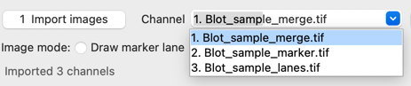
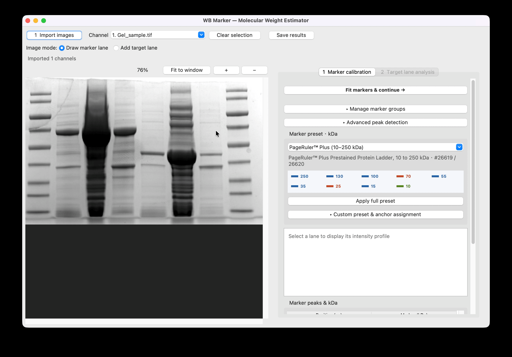
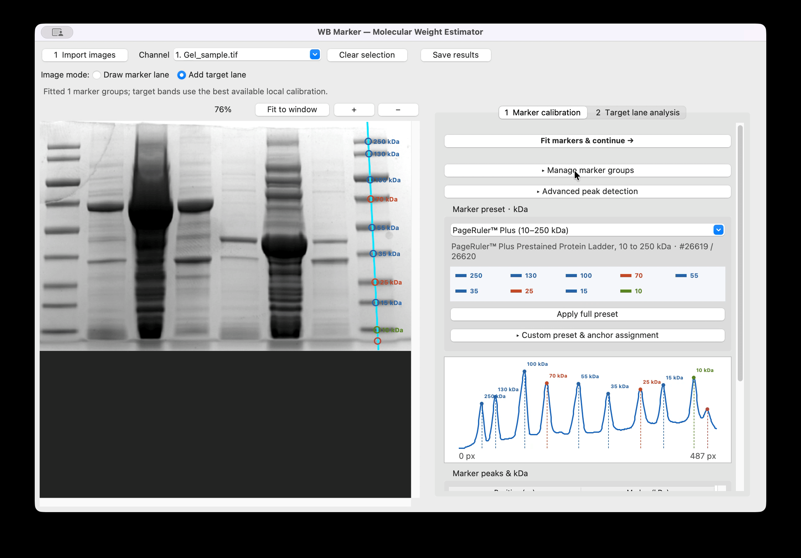
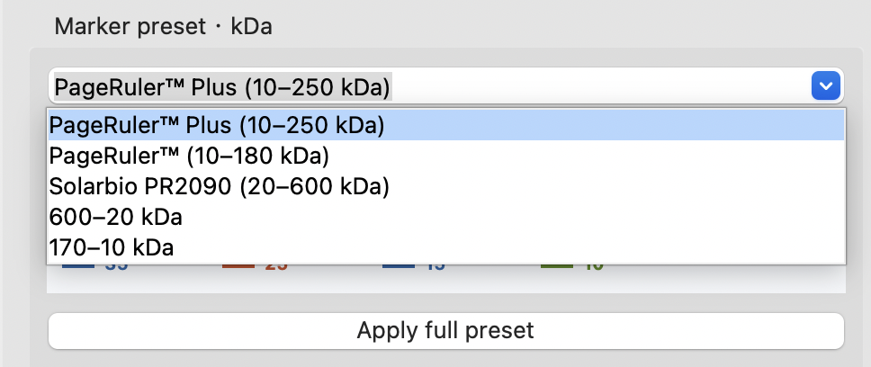
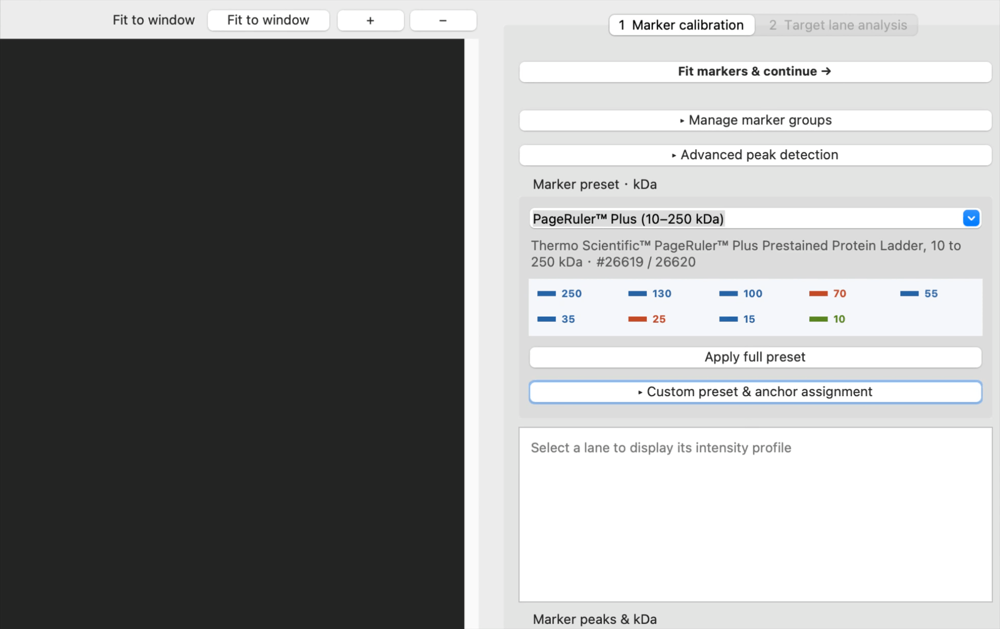

# WB Marker


**Estimate apparent protein molecular weight from Western blot images — directly on your Mac.**

Draw a marker lane, automatically assign a ladder preset, fit the calibration, and draw target lanes to identify bands and estimate their apparent molecular weights. Review the detected peaks, confidence, and uncertainty before exporting your results. Images are processed locally and are not uploaded.

[](https://github.com/Tsutayaaa/wb_tool/releases/tag/v1.0.0)

**Download → Unzip → Move to Applications → Open** · No Python required.

[How to use](#how-to-use) · [Import images & channels](#1-import-images-and-channels) · [中文说明](docs/wb-marker.md)

## A note from the developer

I built WB Marker to help researchers quickly estimate apparent molecular weight and support day-to-day experimental work. My aim is to make image-based comparisons more consistent and reproducible through an explicit calibration workflow.

PAGE and Western blot migration provide approximate size comparisons; band intensity can support semiquantitative analysis under appropriate experimental conditions. This tool estimates apparent molecular weight from migration—it does not establish protein identity or a precise molecular mass. Its numerical outputs are not standalone evidence and cannot, by themselves, support an experimental conclusion. Please interpret them alongside appropriate controls, the original images, and independent validation.

Use WB Marker as a practical aid for preliminary assessment and planning follow-up experiments. A consistent analysis procedure helps with comparison, but does not remove the limitations of the underlying experiment.

## Download and install

1. Open **[v1.0.0 Release](https://github.com/Tsutayaaa/wb_tool/releases/tag/v1.0.0)** and download the macOS arm64 ZIP from **Assets**. Choose the app ZIP, rather than GitHub’s automatically generated source-code archives.
2. Extract the ZIP and drag **WB Marker.app** into **Applications**.
3. Double-click the app to start. **No Python or dependency installation is required.**

**Compatibility:** macOS on Apple Silicon (M1 or later). Intel Mac, Windows, and Linux builds are not currently provided. The **v1.0.0 stable release** includes the target-band annotation fix and the custom app icon.

The app is not Developer ID signed or Apple notarized. If macOS blocks the first launch and you trust the download, follow [Apple’s instructions](https://support.apple.com/en-us/102445) to approve it in **System Settings → Privacy & Security**.

To update, quit the app and replace the old copy in Applications. Custom presets and language preferences are retained separately. The interface defaults to English; choose **Language / 语言 → 简体中文** for Chinese, then save your results and restart.

## What you can do

- **Calibrate from marker lanes:** detect peaks automatically, apply named ladder presets, and correct assignments manually.
- **Analyze multiple target lanes:** see band positions on the image and intensity profile, with results organized by lane.
- **Use separate marker and target channels:** import aligned images from the same blot and switch between them during analysis.
- **Compare multiple marker groups:** calibrate more than one marker lane and select a suitable calibration for each target band automatically.
- **Inspect and export results:** review report text, confidence, uncertainty, and calibration diagnostics; save CSV, Excel, or JSON.

## How to use

### 1. Import images and channels

Click **1 Import images** to select your gel or blot images. **You can select multiple files in the file picker and import them together in one step** (Command-click individual files or Shift-click a range on macOS). PNG, JPEG, TIFF, and BMP are supported.

Use dark bands on a light background. Navigate with **Fit to window**, **+ / −**, scrollbars, or Command + mouse wheel.

On a Western blot, the visible marker and target-protein signal may be captured in separate images. Select those images together when importing, then switch between them using **Channel**.



For example, the screenshot shows three imported channels:

| Channel | Typical use |
| --- | --- |
| `Blot_sample_merge.tif` | Inspect the combined image and overall alignment |
| `Blot_sample_marker.tif` | Draw the marker lane, assign kDa, and fit calibration |
| `Blot_sample_lanes.tif` | Draw target lanes and analyze the protein signal |

Calibrate on the **marker channel**, then switch to the **target channel** and add target lanes. The calibration remains available across channels, so marker and target bands do not need to be visible in the same image. A merged image is optional.

**Images must already be aligned in pixel coordinates and should have identical dimensions.** Export channels with the same crop, scale, and orientation. The app does not automatically register images; independently cropped or resized channels can produce incorrect estimates.

Here “channels” are separately imported image files. Export the layers/channels from your imaging software before importing them.

### 2. Draw the marker lane and apply a preset

1. Select **Draw marker lane**.
2. Drag down the center of the marker lane, from the loading-well/top direction toward the bottom.
3. Review the detected peaks on the image and intensity profile.
4. Choose your ladder under **Marker preset · kDa**, then click **Apply full preset** to fill the detected peaks in migration order.
5. Verify the kDa assignments, then click **Fit markers & continue →**.



**Check assignments before fitting.** Applying a preset fills values in order; it does not identify the ladder or determine which bands are missing. Extra peaks, faint bands, or a missing marker band can shift the assignments.

Click the intensity profile to add or remove peaks, and double-click a kDa cell to edit its value. Leave unidentified peaks blank. Calibration requires at least two known peaks at distinct positions, with kDa decreasing along migration. Expand **Advanced peak detection** when smoothing, prominence, spacing, or lane half-width needs adjustment.

### 3. Draw target lanes and inspect the bands

After fitting, the app opens **Target lane analysis**.

1. If necessary, switch **Channel** to the target-protein image.
2. Select **Add target lane** and drag down its center, in the same migration direction as the marker lane.
3. The app detects bands and marks them on both the image and the lane intensity profile.
4. Add more lanes, then select a lane in **Target lanes** to review its peaks.
5. Read the **Band results by lane** table. Select a result and expand **Selected band details** to inspect its marker group, local estimate, uncertainty range, and range status.



Click the target profile to add or remove peaks manually. To change detection settings, expand **Advanced peak detection** and click **Re-detect selected lane**. Review automatic detections before reporting results.

### 4. Save your results

Click **Save results** and choose **CSV**, **Excel (.xlsx)**, or **JSON**. Excel places **Lane summary** first, with detailed estimates in **Band results**.

The app also saves companion reports in the same folder:

| File | Contents |
| --- | --- |
| `lane_summary.csv` | One row per lane, with its band estimates |
| `calibration_report.csv` | Marker back-calculation and local leave-one-out errors |
| `fit_summary.csv` | Global fit and local cross-validation metrics |
| `calibration_diagnostic*.svg` | Marker points, interpolation, global fit, and residuals |
| `calibration_error_vs_mw*.svg` | Calibration errors versus marker molecular weight |

**Save each analysis in a separate folder** to avoid overwriting companion reports. Exports contain results and diagnostics; they do not restore an editable analysis session. Save results before quitting or restarting the app.

## Marker presets and reference colors

Choose a preset to preview its nominal kDa values and fill your marker peaks automatically. The full product name and catalog numbers appear below the selector.



| Brand / product | Bands, high → low (kDa) | Reference colors |
| --- | --- | --- |
| **Thermo Scientific™ PageRuler™ Plus Prestained Protein Ladder, 10 to 250 kDa** (#26619 / #26620) | 250, 130, 100, 70, 55, 35, 25, 15, 10 | 70 and 25: orange/red; 10: green; others: blue |
| **Thermo Scientific™ PageRuler™ Prestained Protein Ladder, 10 to 180 kDa** (#26616 / #26617) | 180, 130, 100, 70, 55, 40, 35, 25, 15, 10 | 70: orange/red; 10: green; others, including 25: blue |
| **Solarbio 3-color Pre-dyed Protein Marker, 20–600 kDa** (PR2090) | 600, 400, 250, 230, 130, 110, 75, 45, 20 | 75: red; 20: green; others: blue |
| **Generic 170–10 kDa** (not assigned to a brand) | 170, 130, 100, 70, 55, 40, 35, 25, 15, 10 | No product-specific reference colors |

The older **600–20 kDa** generic entry remains available for compatibility; use **Solarbio PR2090 (20–600 kDa)** for its product name and reference colors.

After applying a product preset, its reference colors appear in the marker table, profile, and image annotations. Colors help orient the ladder; they do not classify bands automatically. Verify the nominal values against your product documentation and gel system.

### Create your own marker preset

**You can use ladders from any brand by defining your own preset.**

1. Expand **Custom preset & anchor assignment**.
2. Enter the known molecular weights from high to low, separated by spaces or commas, for example `180, 130, 100, 70, 55, 40, 35, 25, 15, 10`.
3. Click **Save new preset** and give it a recognizable brand/product name.
4. Choose the saved preset and click **Apply full preset**, then verify its correspondence to the detected peaks.



Saved presets remain available after restarting or replacing the app. If only part of a ladder is visible, select a known peak and use **Assign downward from selected peak**. Custom presets store molecular weight values; product-specific colors are provided for the named built-in ladders.

Product references: [Solarbio PR2090](https://www.solarbio.com/goodsInfo?id=365799) · [PageRuler Plus](https://www.thermofisher.com/order/catalog/product/26619) · [PageRuler](https://www.thermofisher.com/order/catalog/product/26616).

## Additional controls

Advanced controls are collapsed to keep the main workflow compact:

| Control | Use it to… |
| --- | --- |
| **Manage marker groups** | Select or remove a calibration group after drawing multiple marker lanes |
| **Advanced peak detection** | Adjust smoothing, prominence, minimum peak spacing, and lane half-width |
| **Custom preset & anchor assignment** | Save custom ladders or assign downward from a known band |
| **Calibration diagnostics** | Inspect the detailed fit and cross-validation summary |
| **Selected band details** | Inspect the full estimate behind a compact result row |

Each marker group retains its own assignments and product association. With multiple fitted groups, the app selects calibration separately for each target band, prioritizing range coverage and estimated uncertainty.

## Understanding the estimates

The recommended value comes from **local log-linear interpolation between neighboring markers**. A global linear regression is also calculated for diagnostics. Peak widths and local leave-one-out calibration errors contribute to a heuristic uncertainty range.

Report results as **apparent molecular weight**, rather than exact protein mass. The uncertainty range is not a validated statistical confidence interval. Bands outside the marker range are flagged as extrapolations with very low confidence and preferentially reported as above/below the calibrated range. Gel distortion, transfer, glycosylation, aggregation, and unusual migration can introduce systematic error even with a high R².

## Troubleshooting

| Issue | What to check |
| --- | --- |
| macOS blocks the app | Confirm the download is trusted and follow [Apple’s opening-app guidance](https://support.apple.com/en-us/102445). |
| Target bands are detected but points do not appear | Install the [v1.0.0 stable release](https://github.com/Tsutayaaa/wb_tool/releases/tag/v1.0.0). |
| Too many or too few peaks | Check image polarity and lane placement; adjust advanced detection settings or edit peaks manually. |
| Preset assignments do not match the ladder | Remove false peaks, check missing bands, and edit kDa values or assign from a known anchor. |
| Calibration fails | Assign at least two finite, positive kDa values at distinct positions, descending along migration. |
| Different channels produce inconsistent positions | Verify pixel alignment, dimensions, crop, and orientation. |
| Language has not changed | Save results, quit, and reopen after selecting the language. |

---

## For developers

The sections above describe the packaged app. Source usage requires **macOS and Python 3.10+ with Tk support**.

### Run from source

```bash
git clone https://github.com/Tsutayaaa/wb_tool.git
cd wb_tool
python3 -m tkinter  # Verify Tk works, then close the demo window.
python3 -m venv .venv
source .venv/bin/activate
python -m pip install -r requirements.txt
python -m wb_tools
```

Use `python -m wb_tools --language en` or `--language zh` for a single-launch language override. `python main.py`, `python wb_marker_tool.py`, and the macOS `run_wb_tool.command` launcher remain supported. The launcher creates a virtual environment and installs missing dependencies on first use.

### Test and build

```bash
python -m pip install -r requirements-dev.txt
python -m pytest -q
# Optional real-window tests in a desktop session:
WB_MARKER_GUI_TESTS=1 python -m pytest -q

python3 -m venv .venv-build
.venv-build/bin/python -m pip install -r requirements-build-lock.txt
.venv-build/bin/python scripts/build_app.py
```

Build output: `dist/WB Marker.app`. See the [build and distribution guide](docs/packaging.md) for architecture, ZIP packaging, and signing details.

### Calculation API


The numerical core does not require a graphical display:

```python
from wb_tools.core import prepare_markers, linear_fit, estimate_band

positions = [25, 94, 124, 141, 215, 307, 362, 422, 478]
weights_kda = [600, 400, 250, 230, 130, 110, 75, 45, 20]
markers = prepare_markers(positions, weights_kda)
fit = linear_fit(positions, weights_kda)
result = estimate_band(markers, fit, position_px=94.3, peak_width_px=8)

print(result.apparent_mw_local_kda)  # approximately 398 kDa
print(result.reported_mw_text)
print(result.confidence)
```

Run from the repository root with its virtual environment active, or install the package into that environment with `python -m pip install -e .`. Use consistent pixel coordinates for markers and target positions.

### Source layout

- `wb_tools/core.py`: calibration, peak detection, uncertainty, and result organization.
- `wb_tools/imaging.py`: lane intensity sampling.
- `wb_tools/gui.py`: interface and export workflow.
- `wb_tools/presets.py`: named ladder values and reference colors.
- `wb_tools/i18n.py`: English/Chinese messages and preferences.
- `tests/`: calculation and GUI regression tests.

User settings are stored under `~/Library/Application Support/WB Marker/`. The historical SprB builder is not included in this checkout; its old instructions are retained in [the archived notes](docs/sprb-legacy.md).

## AI disclosure and acknowledgments

WB Marker is independently developed and maintained by [Tsutayaaa](https://github.com/Tsutayaaa). The project’s direction, feature decisions, and final review are the developer’s responsibility.

OpenAI Codex was used as an AI development assistant for implementation, refactoring, debugging, testing, packaging, and documentation. Special thanks to Codex for its efficient assistance and ability to turn ideas into working features.
