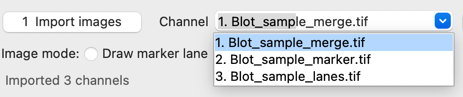
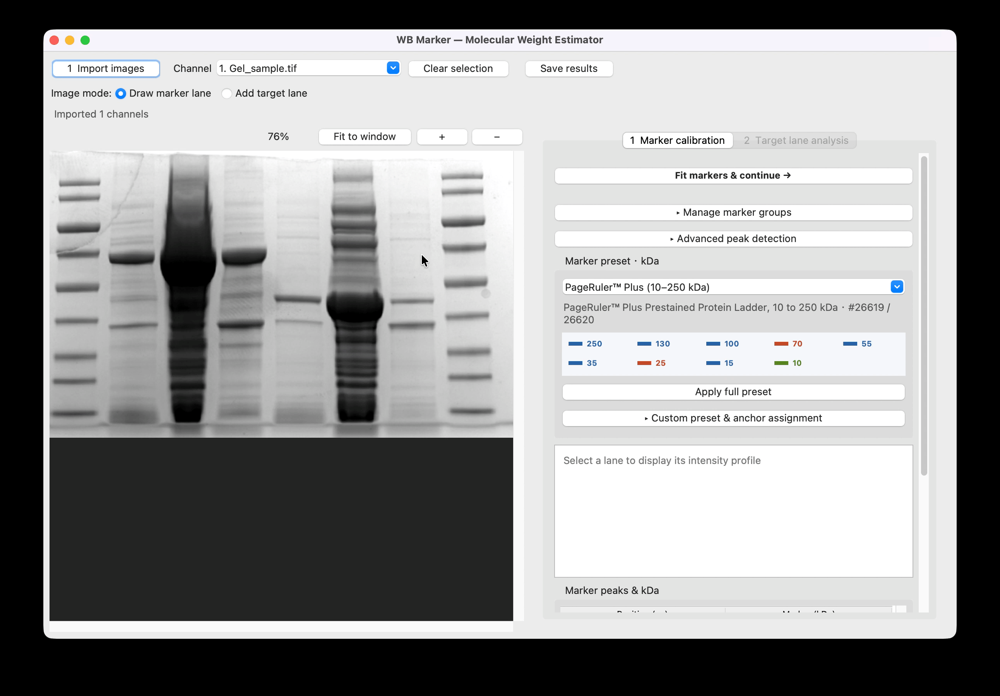
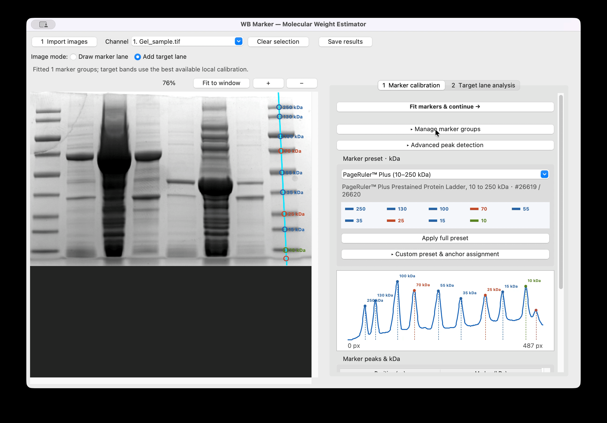
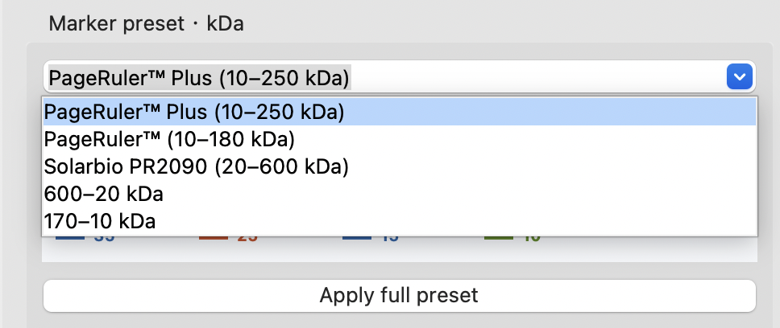
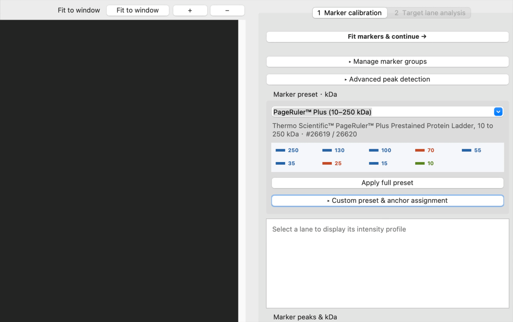

# WB Marker 中文说明


**在 Mac 上快速估算 Western blot 条带的表观分子量。**

[English README](../README.md) · [下载 v1.0.0 正式版](https://github.com/Tsutayaaa/wb_tool/releases/tag/v1.0.0)

## 作者说明

本工具由我独立开发，目的是帮助实验人员快速估算表观分子量、辅助实验判断，并通过明确的校准流程提高分析的一致性与可重复性。

PAGE 和 Western blot 的迁移位置用于近似大小比较；条带强度在合适的实验条件下可支持半定量分析。本工具根据迁移位置估算表观分子量，不能确定蛋白身份或精确分子质量。输出不能独立作为证据，也不能单独支撑实验结论，应结合原始图像、实验对照与独立验证解释。

## 下载与安装

1. 打开 [v1.0.0 Release](https://github.com/Tsutayaaa/wb_tool/releases/tag/v1.0.0)，从 **Assets** 下载 `WB-Marker-v1.0.0-macOS-arm64.zip`，不要选择自动生成的源码压缩包。
2. 解压后将 **WB Marker.app** 拖到“应用程序”。
3. 双击启动，**无需安装 Python 或依赖**。

目前仅提供 **Apple Silicon Mac（M1 或更新芯片）**版本，不提供 Intel Mac、Windows 或 Linux 安装包。此版本未使用 Developer ID 签名或 Apple 公证。如果首次启动被拦截，确认来源可信后按 [Apple 官方说明](https://support.apple.com/zh-cn/102445)在“系统设置 → 隐私与安全”中允许打开。

默认英文界面。在 **Language / 语言** 菜单选择“简体中文”，保存结果后退出并重启生效。更新时退出旧版本，再替换 App；自定义预设和语言设置会保留。

## 使用教程

### 1. 导入图片与多通道

点击 **1 Import images / 导入多张图片**。可在文件选择窗口按住 Command 多选，或按 Shift 连选，**一次导入多张** PNG、JPEG、TIFF 或 BMP 图片。请使用深色条带、浅色背景的图像。

WB 的 Marker 与目标蛋白信号可能位于不同图层。先从成像软件导出各通道图片，一起导入，再通过 **Channel / 当前通道** 切换。



- `Blot_sample_merge.tif`：合并图，用于观察整体位置，可选。
- `Blot_sample_marker.tif`：Marker 通道，用于画线、赋值和拟合。
- `Blot_sample_lanes.tif`：目标蛋白通道，用于画目标泳道并识别条带。

在 Marker 通道完成定标后，可切换到目标通道继续分析，校准信息跨通道保留。图片必须预先完成像素对齐，并保持相同尺寸、裁剪、缩放和方向；App 不会自动配准图片。

### 2. 画 Marker、自动填充预设并拟合

1. 切换到 Marker 通道，选择 **Draw marker lane / 画 Marker 选线**。
2. 从加样孔方向沿泳道中心向下拖动，自动识别峰。
3. 在预设列表选择实际使用的产品，点击 **Apply full preset / 应用完整预设**。
4. 核对峰与 kDa 的对应关系，再点击 **Fit markers & continue / 完成 Marker 并立即拟合**。



预设按峰顺序填写，不会自动判断产品身份或缺失条带。多余峰、弱峰或漏峰可能造成错位。点击灰度曲线可增删峰，双击 kDa 单元格可修改分子量，无法确定的峰可留空。至少需要两个位置不同、kDa 随迁移方向递减的已知峰。

需要调整时展开“高级峰检测参数”；画多条 Marker 泳道后，展开“管理 Marker 泳道组”切换或删除组。“校准诊断详情”提供拟合和交叉验证信息。

### 3. 画目标泳道并查看结果

1. 拟合完成后进入目标分析页，按需切换至目标蛋白通道。
2. 选择 **Add target lane / 添加目标泳道**，沿泳道中心从上向下拖动。
3. 查看原图与灰度曲线中的条带标点，可继续添加多个泳道。
4. 在泳道列表中选择泳道，检查检测峰；点击曲线可手动增删。
5. 结果表显示泳道、条带、建议报告和可信度；选中结果并展开“所选条带详情”查看 Marker 组、局部估计、不确定范围和范围状态。



若需调整参数，展开“高级峰检测参数”后重新识别所选泳道。斜泳道、胶畸变与通道错位均可能影响估算，应人工核对。

### 4. 保存与导出

点击 **Save results / 保存结果**，选择 CSV、XLSX 或 JSON。Excel 的 `Lane summary` 为泳道汇总，`Band results` 为逐条带详细结果；同时输出校准报告、拟合汇总和 SVG 诊断图。

**每次分析请使用独立输出文件夹**，避免覆盖同名附属报告。导出文件不是可恢复的分析工程，退出前请保存结果。切换语言需要重启，也请先保存。

## 内置 Marker 与自定义预设



| 品牌与产品 | 分子量（kDa，从高到低） | 参考色带 |
| --- | --- | --- |
| Thermo Scientific PageRuler Plus，10–250 kDa，26619 / 26620 | 250、130、100、70、55、35、25、15、10 | 70/25 橙红；10 绿；其余蓝 |
| Thermo Scientific PageRuler，10–180 kDa，26616 / 26617 | 180、130、100、70、55、40、35、25、15、10 | 70 橙红；10 绿；其余含 25 均为蓝 |
| Solarbio 三色预染蛋白 Marker，20–600 kDa，PR2090 | 600、400、250、230、130、110、75、45、20 | 75 红；20 绿；其余蓝 |
| 通用 170–10 kDa（未指定品牌） | 170、130、100、70、55、40、35、25、15、10 | 无产品专属色带 |

旧的通用 `600–20 kDa` 入口仍保留；使用 Solarbio 具名预设可显示对应产品与参考颜色。色带仅辅助核对，不代表自动识别条带身份。

**任意品牌都可以自行设置预设：**

1. 展开“自定义预设与锚点排列”。
2. 输入从高到低的分子量列表，用空格或逗号分隔。
3. 点击“另存为新预设”，填写品牌或产品名称。
4. 选择保存后的预设并应用，核对对应关系。



预设在下次启动后保留。如果只显示部分梯子，可选中已知峰，设置锚点 kDa，再从该峰向下自动排列。自定义预设保存分子量，专属参考颜色由内置产品提供。

产品资料：[Solarbio PR2090](https://www.solarbio.com/goodsInfo?id=365799) · [PageRuler Plus](https://www.thermofisher.com/order/catalog/product/26619) · [PageRuler](https://www.thermofisher.com/order/catalog/product/26616)。

## 分子量计算方法

默认结果不再来自整段 Marker 的单一直线，而是使用目标位置上下最近的两个 Marker，在 `position_px` 与 `log10(MW)` 之间做局部线性插值：

```text
logMW = log10(MW1) + (x-x1)/(x2-x1) × (log10(MW2)-log10(MW1))
MW_local = 10^logMW
```

全局模型仍会计算：

```text
log10(MW_kDa) = slope × position_px + intercept
```

但它仅用于输出 `apparent_MW_global_kDa`、R²、log10 RMSE 和 Marker back-calculation error。最终推荐值为 `apparent_MW_local_kDa`。Local 与 global 相差超过 10% 时会自动产生警告。

### 多 Marker 组自动择优

每个目标 band 会分别使用所有已成功拟合的 Marker 组计算结果。选择顺序为：

1. 优先选择目标位置落在该 Marker 组覆盖范围内的正常 interpolation；
2. 其次考虑 near-boundary；只有没有正常覆盖时才采用 extrapolation；
3. 在相同范围状态下，选择由 local CV、band 峰宽和 Marker 峰宽共同得到的综合不确定度最低者；
4. 再以 confidence 和 local/global 差异作为平局判据。

因此并不是简单选择 R² 最高的 Marker，而是针对每一个目标条带分别选择最可靠的局部校准。输出会记录 `marker_group_used`、`marker_groups_compared` 和 `marker_selection_reason`，便于审计。

## 不确定度与可信度

- 对每个内部 Marker 做 leave-one-out：移除该点，用上下 Marker 局部插值预测它，再计算相对误差。
- 目标 band 优先使用相邻 Marker 的 LOO-CV 误差；局部信息不足时使用所有内部 Marker 的 CV 中位误差。
- 峰宽使用灰度峰的 FWHM。中心位置不确定度取 `max(2 px, FWHM/4)`；`±2 px` 是无法从窄峰获得更可靠信息时的保守下限。
- 相邻 Marker 的位置不确定度与 band 位置不确定度按平方和组合。
- 校准误差与位置误差在 log10(MW) 空间合并，再转换成 `MW_lower_kDa` 和 `MW_upper_kDa`。
- `high / medium / low / very_low` 由局部 CV 误差、位置误差、local/global 差异、Marker 间隔、边界位置和是否外推综合评分，不依赖单一阈值。
- 超出最高或最低 Marker 时分别标记 `extrapolation_high_MW` 或 `extrapolation_low_MW`，可信度强制为 `very_low`，并优先报告 `>最高 Marker` 或 `<最低 Marker`。

## 输出文件

主 CSV/XLSX 的每条 band 包括：

```text
lane, channel, band, marker_group_used, marker_groups_compared
marker_selection_reason, position_px, peak_width_px, position_uncertainty_px
nearest_upper_marker_kDa, nearest_upper_marker_position_px
nearest_lower_marker_kDa, nearest_lower_marker_position_px
apparent_MW_local_kDa, apparent_MW_global_kDa
local_global_difference_percent
MW_lower_kDa, MW_upper_kDa, relative_uncertainty_percent
range_status, confidence, reported_MW, reported_MW_text, warnings
```

每次保存还会在同一目录生成：

- `lane_summary.csv`：每行一个泳道，将该泳道的 `Band 1 / Band 2 / ...` 建议分子量排列在同一行，并汇总位置、采用的 Marker 组、可信度和警告数；
- `calibration_report.csv`：按 Marker 组列出每个 Marker 的 global 回算误差与 local leave-one-out 误差；
- `fit_summary.csv`：global regression 与 local CV 汇总指标；
- `calibration_diagnostic*.svg`：各 Marker 组的 Marker 点、global 直线、local 分段线和 global residual；
- `calibration_error_vs_mw*.svg`：各 Marker 组的 global 与 local LOO 相对误差随 Marker MW 的变化。

选择 XLSX 时，`Lane summary` 位于第一个工作表，逐条带原始结果保存在 `Band results`，因此既方便按泳道比较，也不会丢失详细结果。

## 回归测试示例

示例 Marker 为 `600@25, 400@94, 250@124, 230@141, 130@215, 110@307, 75@362, 45@422, 20@478`。当前测试得到：

| band position | Local kDa | Global kDa | 建议报告 |
|---:|---:|---:|---|
| 54.9 px | 503.3 | 463.0 | `~500 kDa` |
| 77.9 px | 439.7 | 396.9 | `~440 kDa` |
| 94.3 px | 398.1 | 355.7 | `~400 kDa` |
| 195 px | 151.7 | 181.3 | `~150 kDa` |
| 272 px | 117.2 | 108.3 | `~120 kDa` |

因此接近 `400 kDa @ 94 px` 的目标条带会自然得到约 400 kDa，而不会再默认采用 global regression 的约 356 kDa。

## 实验与解释注意事项

- 建议按从高分子到低分子的顺序画线，并确认 Marker kDa 随迁移位置整体递减。
- `R²` 反映这些 Marker 点在线性模型下的一致性，但不能消除胶浓度、转膜、糖基化、聚集或 SDS 结合异常带来的系统误差。
- 超出 Marker 覆盖范围属于外推，应报告较宽范围或 `> 某值`，不要给出虚假的小数精度。
- 工具输出应写作“表观分子量约为 … kDa”，而非精确真实分子量。

## 开发与源码

需要 macOS、Python 3.10+ 和可用的 Tk。完整开发和打包说明见 [英文 README](../README.md#for-developers) 与 [打包指南](packaging.md)。

```bash
git clone https://github.com/Tsutayaaa/wb_tool.git
cd wb_tool
python3 -m venv .venv
source .venv/bin/activate
python -m pip install -r requirements.txt
python -m wb_tools --language zh
```

用户设置保存在 `~/Library/Application Support/WB Marker/`。

## AI 声明与致谢

本工具由 [Tsutayaaa](https://github.com/Tsutayaaa) 独立开发与维护，项目方向、功能取舍及最终审核由开发者负责。开发过程中使用 OpenAI Codex 辅助实现、重构、调试、测试、打包与文档编写。感谢 Codex 提供的高效帮助，以及将想法落实为可用功能的能力。
